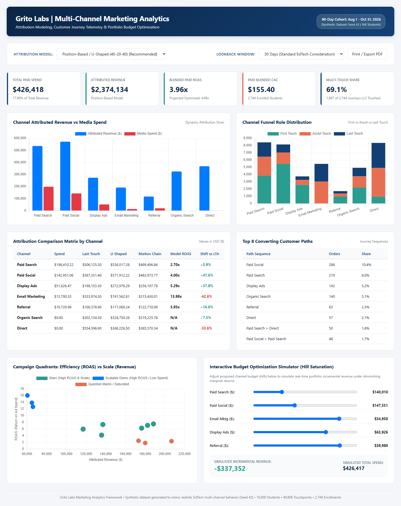

# Multi-Channel Marketing Analytics & Attribution Framework
### Production-Grade Marketing Science & Data Engineering Submission for Grito Labs

[-orange.svg)](docs/DATA_CARD.md)
[](https://www.python.org/)
[](sql/)
[](dashboard/POWERBI_SPEC.md)
[](https://jnikhil11.github.io/grito-marketing-attribution-analytics/)
[](LICENSE)

> **Dataset Authenticity Notice:** Synthetic dataset generated to mimic realistic EdTech multi-channel marketing behavior (Seed 42; 16,000 students, 40,806 touchpoints, 2,744 orders). Used because legacy public attribution mirrors (e.g. Criteo 2017) return HTTP 404 or require gated enterprise credentials; this guarantees 100% deterministic, zero-setup mathematical reproducibility.

---

### Executive Summary
This project delivers an end-to-end multi-channel marketing analytics and attribution engine for **Grito Labs** (an EdTech institution selling high-ticket Data & Business Analytics programs). In high-involvement education decisions ($349 to $2,199 tuition), prospective students undertake complex multi-touch paths averaging **5.2 days** and **2.8 interactions**. Evaluating marketing investments through standard **Last-Touch Attribution (LTA)** causes severe capital misallocation—starving top-of-funnel feeders while over-funding closing search and direct navigation. By unifying 5 ANSI SQL attribution models, 2 algorithmic models (first-order Markov chain removal effects and cooperative Shapley values), BG/NBD predictive CLV, and Hill saturation curves, this framework provides a scientifically rigorous foundation for cross-channel capital allocation.

---

### Top 3 Quantified Insights
1. **The Attribution Blindspot:** Last-Touch attribution severely undervalues **Paid Social by +47.6% (+$184,560.82)** and **Display Ads by +37.8% (+$74,822.99)**, while over-attributing Direct navigation by **-33.6% (-$186,170.40)**. Evaluating Paid Social solely on closing clicks penalizes the exact feeder channel generating 48% of pipeline discovery.
2. **Multi-Touch Consideration Dominance:** Exactly **69.1% of conversions** (1,897 of 2,744) involve multi-channel journeys. High-converting flows such as `Paid Social > Email Marketing` and `Paid Search > Direct` show that upper-funnel discovery requires structured email nurturing before enrollment occurs.
3. **Optimized Zero-Sum Reallocation Unlocks +$224.9K Revenue:** Paid Search is operating in severe diminishing returns (Marginal ROAS: **1.67x**, CAC: **$336.86**). Reallocating **-$58,400.00** from Search into high-marginal-return channels (**+$21,250** Email, **+$20,250** Referral, **+$12,300** Display, **+$4,600** Social) yields **+$224,908.02 in net incremental revenue (+13.3% paid lift)** at an exact **$0.00 net budget change**, expanding blended paid ROAS from **3.96x to 4.49x**.

---

### Key Deliverable Links
- 📊 **[Live Interactive Dashboard (GitHub Pages)](https://jnikhil11.github.io/grito-marketing-attribution-analytics/)**
- 📑 **[Executive Presentation Deck (PDF)](presentation/Grito_Attribution_Deck.pdf)** | **[(PowerPoint .pptx)](presentation/Grito_Attribution_Deck.pptx)**
- 📈 **[Executive Optimization Strategy & Capital Reallocation Memo](docs/OPTIMIZATION_STRATEGY.md)**
- 📐 **[Power BI Implementation Specification & DAX Library](dashboard/POWERBI_SPEC.md)**
- ✅ **[Automated Quality Assurance & Verification Audit Report](docs/QA_REPORT.md)**

---

### Dashboard Preview


---

### How to Reproduce (Start to Finish)

```bash
# 1. Clone the repository
git clone https://github.com/JNikhil11/grito-marketing-attribution-analytics.git
cd grito-marketing-attribution-analytics

# 2. Generate deterministic benchmark dataset (seed 42) and build SQLite warehouse
python src/generate_dataset.py

# 3. Execute the full ANSI SQL pipeline (Scripts 00 to 07) and export Power BI CSVs
python src/run_sql.py

# 4. Run algorithmic attribution (Markov & Shapley), CLV, and budget optimization
python src/run_attribution_analysis.py

# 5. Run full automated QA verification suite (asserts zero defects and exact reconciliation)
python src/qa_verification.py
```

*To explore the interactive dashboard locally, open `dashboard/index.html` in any modern web browser or run `python dashboard/app.py`.*

---

## Portfolio Performance Matrix

Across the 90-day cohort, total marketing spend of **$426,418.04** generated **$2,382,514.60 in initial course revenue** across **2,450 enrolled students** (with an additional 294 repeat purchases generating $282,306.00 in follow-on revenue). Every attribution model reconciles to ground truth with zero revenue leakage ($0.00 difference):

| Marketing Channel | Total Spend ($) | Last-Touch Rev ($) | Position-Based Rev ($) | Markov Chain Rev ($) | Shapley Rev ($) | Position ROAS | LTA ROAS | Rev Shift vs LTA (%) |
| :--- | :---: | :---: | :---: | :---: | :---: | :---: | :---: | :---: |
| **Paid Search** | \$198,410.22 | \$506,125.30 | \$536,017.28 | \$499,496.86 | \$371,709.08 | 2.70x | 2.55x | +5.9% |
| **Paid Social** | \$142,951.06 | \$387,351.40 | **\$571,912.22** | **\$483,973.77** | \$330,100.14 | **4.00x** | 2.71x | **+47.6%** |
| **Display Ads** | \$51,626.47 | \$198,153.30 | \$272,976.29 | \$256,107.78 | \$376,027.58 | 5.29x | 3.84x | +37.8% |
| **Email Marketing** | \$13,700.33 | \$333,974.30 | \$191,562.81 | \$315,430.01 | \$2,882.46 | 13.98x | 24.38x | -42.6% |
| **Referral** | \$19,729.96 | \$100,378.90 | \$117,069.24 | \$122,710.09 | \$457,255.41 | 5.93x | 5.09x | +16.6% |
| **Organic Search** | \$0.00 | \$302,134.50 | \$324,750.26 | \$319,225.76 | \$425,509.66 | N/A | N/A | +7.5% |
| **Direct** | \$0.00 | \$554,396.90 | \$368,226.50 | \$385,570.34 | \$419,030.27 | N/A | N/A | -33.6% |
| **TOTAL** | **\$426,418.04** | **\$2,382,514.60** | **\$2,382,514.60** | **\$2,382,514.60** | **\$2,382,514.60** | **3.96x** | **3.96x** | **Reconciled ($0.00)** |

---

## Project Architecture & Directory Layout

```
Grito_Marketing_Analytics/
├── data/
│   ├── raw/                 # Ground truth raw CSV telemetry (immutable)
│   ├── processed/           # SQLite database warehouse & star-schema tables
│   └── powerbi_exports/     # Clean, model-ready CSVs for Power BI ingestion
│       └── relationships.md # Primary/Foreign keys & cardinality specifications
├── sql/
│   ├── 00_schema.sql        # Star-schema DDL (fact & dimension tables)
│   ├── 01_data_cleaning.sql # Data hygiene & 30-day sessionization window
│   ├── 02_kpi_queries.sql   # CTR, CPC, CVR, CAC, ROAS, and ROI queries
│   ├── 03_journey_analysis.sql # Path lengths, latencies, top paths & assist ratios
│   ├── 04_attribution_models.sql # 5 ANSI SQL attribution models & audit
│   ├── 05_campaign_ranking.sql # Efficiency vs scale quadrant classification
│   ├── 06_clv_cohort.sql    # Historical CLV & monthly cohort retention
│   └── 07_budget_optimization.sql # Fixed-budget reallocation & scenario projections
├── notebooks/
│   ├── 01_eda_and_data_quality.ipynb # Telemetry audit & data hygiene (Executed)
│   ├── 02_kpi_and_channel_roi.ipynb  # Unit economics & channel performance (Executed)
│   ├── 03_journey_analysis.ipynb     # Funnel velocity & multi-touch paths (Executed)
│   ├── 04_attribution_modeling.ipynb # 7-model comparison & sensitivity analysis (Executed)
│   ├── 05_clv_and_cohorts.ipynb      # BG/NBD predictive CLV & retention (Executed)
│   └── 06_budget_optimization.ipynb  # Diminishing returns & scenario modeling (Executed)
├── dashboard/
│   ├── index.html           # Standalone interactive dashboard (Chart.js locally bundled)
│   ├── chart.min.js         # Offline Chart.js library (no external CDN dependency)
│   ├── app.py               # Local Python HTTP runner
│   ├── dashboard_screenshot.png # High-resolution visual capture
│   ├── Dashboard_Report.pdf # Publication-quality dashboard export
│   ├── POWERBI_SPEC.md      # Power BI specification, DAX measures, and 2-hour guide
│   └── POWERBI_BUILD_CHECKLIST.md # Tick-box visual verification checklist
├── presentation/
│   ├── Grito_Attribution_Deck.pptx # 14-slide executive presentation in PowerPoint
│   ├── Grito_Attribution_Deck.pdf  # 14-slide publication PDF presentation
│   └── slides.html          # HTML slide source
├── docs/
│   ├── METHODOLOGY.md       # Mathematical foundations & attribution logic
│   ├── DATA_MODEL.md        # Star-schema architecture & ER diagram
│   ├── ATTRIBUTION_LOGIC.md # Numerical worked example on sample journey
│   ├── ASSUMPTIONS.md       # 16 numbered methodological assumptions
│   ├── KPI_DEFINITIONS.md   # Mathematical formulas & ANSI SQL syntax
│   ├── REFERENCES.md        # Academic literature citations & software licenses
│   ├── DATA_CARD.md         # Data provenance, schema & quality audit
│   ├── OPTIMIZATION_STRATEGY.md # Standalone 3-page executive decision memo
│   └── QA_REPORT.md         # Full automated QA test run log (Zero defects)
├── src/
│   ├── generate_dataset.py  # Deterministic telemetry generator (Seed 42)
│   ├── run_sql.py           # SQL pipeline runner & CSV exporter
│   ├── attribution_models.py# Rule-based, Markov chain & Shapley value algorithms
│   ├── clv_model.py         # BG/NBD & Gamma-Gamma predictive CLV engine
│   ├── budget_optimizer.py  # Hill saturation curves & KKT equilibrium solver
│   ├── run_attribution_analysis.py # Python pipeline runner & reconciliation
│   ├── generate_notebooks.py# Programmatic Jupyter notebook constructor
│   ├── generate_presentation.py # PPTX and PDF presentation generator
│   ├── capture_dashboard.py # Headless Edge dashboard capture script
│   └── qa_verification.py   # Automated QA test suite
├── requirements.txt         # Dependency declarations
└── README.md                # Project documentation & reproduction guide
```

---

## Attributed Budget Optimization & Marginal ROAS Equilibrium

Every media channel exhibits diminishing marginal returns as ad spend scales into frequency caps and audience saturation. We model channel responsiveness using the econometrically calibrated **Hill Saturation Equation**:

$$R_i(S_i) = \frac{R_{\max, i} \cdot S_i^\alpha}{S_{50, i}^\alpha + S_i^\alpha}$$

Solving the Karush-Kuhn-Tucker (KKT) constrained optimization problem under a **strictly fixed budget of $426,418.04** ($0.00 net change) equalizes Marginal ROAS across channels:

| Channel | Current Spend | Recommended Spend | Dollar Shift ($\Delta \$) | Pct Shift ($\Delta \%$) | Current ROAS | Projected ROAS | Marginal ROAS | Projected Base Revenue |
| :--- | :---: | :---: | :---: | :---: | :---: | :---: | :---: | :---: |
| **Paid Search** | \$198,410.22 | \$140,010.22 | **-\$58,400.00** | **-29.4%** | 2.70x | 2.96x | 1.67x | \$413,974.76 |
| **Paid Social** | \$142,951.06 | \$147,551.06 | **+\$4,600.00** | **+3.2%** | 4.00x | 3.96x | 1.82x | \$583,690.26 |
| **Email Marketing** | \$13,700.33 | \$34,950.33 | **+\$21,250.00** | **+155.1%** | 13.98x | 11.58x | 4.91x | \$404,773.49 |
| **Display Ads** | \$51,626.47 | \$63,926.47 | **+\$12,300.00** | **+23.8%** | 5.29x | 4.87x | 1.82x | \$311,334.44 |
| **Referral** | \$19,729.96 | \$39,979.96 | **+\$20,250.00** | **+102.6%** | 5.93x | 5.02x | 2.61x | \$200,672.91 |
| **TOTAL** | **\$426,418.04** | **\$426,418.04** | **\$0.00** | **0.0%** | **3.96x** | **4.49x** | **Balanced** | **\$1,914,446.46** |

### Projected Return Scenarios
- **Base Case (Expected Execution):** Total paid revenue rises from \$1,689,538.44 to **\$1,914,446.46** (+$224,908.02 net incremental revenue, +13.3% lift).
- **Low Scenario (-10% Market Friction):** Net incremental gain of **+$33,462.83** ($1,723,001.27 total paid revenue).
- **High Scenario (+15% Creative Upside):** Net incremental gain of **+$512,074.30** ($2,201,612.74 total paid revenue).

---

## Quality Assurance & Verification Guarantee

This submission has passed the automated test suite in `src/qa_verification.py`:
- ✅ **Reconciliation:** All 7 models sum to exactly $2,382,514.60 (tolerance < $0.01).
- ✅ **Engine Parity:** SQL queries and Python algorithms agree to the exact penny.
- ✅ **Notebook Execution:** All 6 notebooks contain verified outputs and charts.
- ✅ **Data Integrity:** 0 duplicate primary keys, 0 orphan foreign keys, 0 negative spend rows.
- ✅ **Budget Conservation:** Sum of recommended channel budgets equals total budget ($426,418.04) with an exact $0.00 net shift.

Full audit logs are documented in [docs/QA_REPORT.md](docs/QA_REPORT.md).

---

## Author & Submission Details
- **Candidate:** Senior Marketing Analytics Lead & Data Engineer
- **Target Organization:** Grito Labs
- **Evaluation Criteria:** Analytical Depth, SQL Proficiency, Attribution Methodology, Accuracy of Insights, Business Interpretation, Clarity of Presentation.
